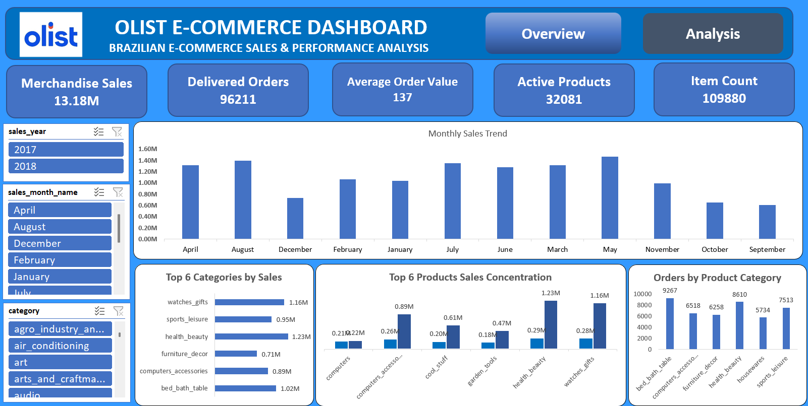

# Olist E-Commerce Business Intelligence Project

### Track B — Products & Categories | SQL Server & Excel

This project analyzes the **Brazilian E-Commerce Public Dataset by Olist** to understand product and category performance in an online marketplace. SQL is used to answer 12 business questions, validate the underlying data, and prepare the datasets used by an interactive Excel dashboard. The findings and business implications are documented in the accompanying report.

> **Analysis period:** 1 January 2017 – 31 August 2018 (purchase date)  
> **Database:** `Olist_BI_TrackB`  
> **Currency:** Brazilian Real (BRL)

---

## Dashboard Preview



The Excel dashboard includes five full-period KPI cards, four charts, and slicers for **Year**, **Month**, and **Product Category**. The KPI cards are intentionally fixed to the full analysis-period baseline; the slicers are intended to filter the chart analysis.

[Open the Excel dashboard](dashboard/OLIST%20E-COMMERCE%20DASHBOARD.xlsx)

## Business Scenario

A product management team at an online marketplace needs a clear view of how the product catalog contributes to sales and where category performance depends on a limited number of products. Using Olist transaction data, this project examines delivered merchandise sales, category rankings, product-level performance, seller exposure to leading categories, and sales concentration. It also reviews selected category-level service signals using delivery dates and valid customer review scores.

The analysis is intended to support decisions such as prioritizing category reviews, monitoring dependence on a small set of products, and reviewing catalog items with no recorded sales in the observed period. The work is **descriptive**: it identifies patterns for further investigation and does not establish causal relationships, profitability, inventory availability, or product discontinuation.

## Project Scope

- **Dataset:** Brazilian E-Commerce Public Dataset by Olist.
- **Track:** Track B — Products and Categories.
- **Questions:** G1–G3 (common questions), B1–B7 (Track B), and O1–O2 (team-defined additional questions).
- **Purchase-date window:** `2017-01-01` inclusive to `2018-09-01` exclusive.
- **Primary population:** Delivered orders within the date window, except where a question explicitly uses another population or comparison period.
- **Sales definition:** Merchandise sales are the sum of item prices (`order_items.price`) for delivered orders. Freight is excluded. This measure is not profit, commission, or net revenue.

## Technology Stack

| Component | Technology |
|---|---|
| Database | Microsoft SQL Server 2022 Developer Edition |
| Query environment / import | SQL Server Management Studio (SSMS) and SQL Server Import Flat File Wizard |
| Dashboard | Microsoft Excel for Microsoft 365 |
| Source data | Olist Brazilian E-Commerce Public Dataset (CSV files) |

## Repository Structure

```text
Olist-BI-Project/
│
├── README.md
├── Backup                         # SQL Server backup archive
├── .gitattributes
│
├── sql/
│   ├── 01_schema.sql
│   ├── 02_validation.sql
│   ├── 03_analysis.sql
│   └── 04_dashboard_exports.sql
│
├── Docs/
│   ├── Data Dictionary and ERD (Docs).pdf
│   ├── ERD.png
│   └── SQL Coverage Map (Docs).pdf
│
├── results/
│   ├── G1_P1.csv
│   ├── G1_P2.csv
│   ├── G2.csv
│   ├── G3_P1.csv
│   ├── G3_P2.csv
│   ├── B1.csv
│   ├── B2.csv
│   ├── B3.csv
│   ├── B4.csv
│   ├── B5.csv
│   ├── B6.csv
│   ├── B7.csv
│   ├── O1.csv
│   └── O2.csv
│
├── dashboard/
│   ├── OLIST E-COMMERCE DASHBOARD.xlsx
│   └── screenshot/
│       └── dashboard.png
│
└── report/
    └── Track_B_Findings_Report.pdf
```

## Dataset

Download the original dataset from Kaggle:

[Brazilian E-Commerce Public Dataset by Olist](https://www.kaggle.com/datasets/olistbr/brazilian-ecommerce)

The project uses these eight source CSV files. The original raw CSV files are not included in this repository; download them separately and keep an unchanged copy locally. The repository also contains a file named `Backup`, which is a SQL Server backup archive; check its contents and sharing permissions before redistributing the repository.

| Source CSV | Required staging table |
|---|---|
| `olist_customers_dataset.csv` | `dbo.stg_customers` |
| `olist_orders_dataset.csv` | `dbo.stg_orders` |
| `olist_order_items_dataset.csv` | `dbo.stg_order_items` |
| `olist_products_dataset.csv` | `dbo.stg_products` |
| `olist_sellers_dataset.csv` | `dbo.stg_sellers` |
| `olist_order_payments_dataset.csv` | `dbo.stg_order_payments` |
| `olist_order_reviews_dataset.csv` | `dbo.stg_order_reviews` |
| `product_category_name_translation.csv` | `dbo.stg_category_translation` |

The geolocation CSV is not required for the questions in this track.

## Database Schema

The final database contains eight core tables:

- `customers`
- `orders`
- `order_items`
- `products`
- `sellers`
- `order_payments`
- `order_reviews`
- `category_translation`

The schema preserves the source tables and their relevant row grains. Primary and foreign key constraints are applied in the final tables. The ER diagram and detailed field definitions, keys, relationships, units, and analytical grains are available in [Data Dictionary and ERD](Docs/Data%20Dictionary%20and%20ERD%20%28Docs%29.pdf) and [ERD image](Docs/ERD.png).

## How to Run the Project

### Prerequisites

- Microsoft SQL Server 2022 (the project was developed with the Developer Edition).
- SQL Server Management Studio (SSMS).
- The eight source CSV files downloaded from the Olist dataset page.
- Microsoft Excel for Microsoft 365 to open and explore the dashboard.

### 1. Download and prepare the source data

Download the Olist dataset from Kaggle and extract the eight required CSV files listed above. Preserve the original files; do not edit them manually in Excel.

### 2. Create the project database

In SSMS, connect to your SQL Server instance and create the database:

```sql
CREATE DATABASE Olist_BI_TrackB;
GO
```

### 3. Import the CSV files into staging tables

Use **SQL Server Import Flat File Wizard** (or an equivalent CSV import process) to import each source file into the matching staging table listed in the Dataset section. The staging table names must use the `stg_` prefix and the expected column names because `01_schema.sql` reads from these tables.

The repository does not contain the original raw CSV files. The import wizard's full configuration settings were not retained in the project, so check column names, data types, text encoding, date parsing, and rejected rows during your import.

### 4. Create and populate the final tables

Open and execute:

```text
sql/01_schema.sql
```

This script creates the eight final tables, transfers records from the staging tables, and applies key constraints. It includes a safety check and will stop if final tables already exist. Do not rerun it against an already-populated database without first reviewing the existing objects and deciding on a clean rebuild.

### 5. Run data validation

Execute:

```text
sql/02_validation.sql
```

This script profiles financial fields, review scores, dates, product attributes, category values, and other data-quality conditions. It reports issues for review; the profiling checks do not automatically delete or modify source records.

### 6. Run the analytical questions

Execute:

```text
sql/03_analysis.sql
```

The script contains the SQL analyses for all 12 questions:

| Question IDs | Analysis area |
|---|---|
| G1–G3 | Common marketplace questions: order status and delivered-order baseline, monthly sales, review and payment coverage |
| B1–B7 | Category contribution, monthly category ranking, product performance, seller exposure, product concentration, product activity across periods, and category service signals |
| O1–O2 | Average selling price per item by category, and catalog products without a delivered sale in the analysis period |

The corresponding query outputs are included in the [`results/`](results/) folder. The [SQL Coverage Map](Docs/SQL%20Coverage%20Map%20%28Docs%29.pdf) maps the required SQL topics to question IDs and explains their analytical purpose.

### 7. Generate the Excel dashboard exports

Execute:

```text
sql/04_dashboard_exports.sql
```

The script returns two result grids, in this order:

1. **KPI baseline** — save the first result grid as `KPI_Baseline.csv`.
2. **Monthly category master** — save the second result grid as `Dashboard_Master_Monthly_Category.csv`.

In SSMS, right-click each result grid and choose **Save Results As...**. Save the files as CSV with column headers. Import both CSV files into Excel and load them as tables before rebuilding or refreshing the dashboard. The export script documents the intended grain, measure definitions, and dashboard mapping.

The monthly category master is designed at one row per **purchase month × category** (20 months × 74 categories = 1,480 rows), with 27 columns. Its measures retain the numerators and denominators needed to recalculate averages and rates after filtering.

### 8. Open the Excel dashboard

Open [`dashboard/OLIST E-COMMERCE DASHBOARD.xlsx`](dashboard/OLIST%20E-COMMERCE%20DASHBOARD.xlsx). The workbook contains the populated dashboard and its PivotTables/source data. The submitted workbook is intended to remain viewable without a live connection to the developer's local SQL Server instance.

The dashboard contains:

**KPI cards**
- Merchandise Sales
- Delivered Orders
- Average Order Value
- Active Products
- Item Count

**Charts**
- Monthly Sales Trend
- Top 6 Categories by Sales
- Top 6 Products Sales Concentration
- Orders by Product Category

**Slicers**
- Year
- Month
- Product Category

The five KPI cards represent the full-period baseline and are intentionally not recalculated by the chart slicers.

## Key Results & Business Findings

### Marketplace baseline

| KPI | Result |
|---|---:|
| Delivered orders | 96,211 |
| Merchandise sales | BRL 13,181,027.13 |
| Average order value | BRL 137.00 |
| Distinct customers | 93,104 |
| Products with delivered sales | 32,081 |
| Categories analyzed | 74 |
| Delivered item rows | 109,880 |

### Key findings

1. **Health & Beauty led category sales**, with BRL 1,229,557.50, representing 9.33% of total merchandise sales.
2. **The five highest-sales categories generated BRL 5,256,875.17**, or 39.88% of merchandise sales.
3. **November 2017 was the highest-sales month**, with BRL 987,765.37 in delivered merchandise sales.
4. **Product concentration varied substantially by category.** The top five products represented 97.27% of sales in `portateis_cozinha_e_preparadores_de_alimentos`, compared with 4.23% in Sports & Leisure.
5. **6,882 products exceeded their own category's average product sales**, across 73 categories.
6. **1,234 sellers had sales in the five leading categories.** The highest selected-category seller sales were BRL 203,724.83; this represented 89.75% of that seller's BRL 226,987.93 total sales.
7. **Category service signals suggest areas for further review.** Office Furniture had a 21.71% low-rating rate and an 8.09% late-delivery rate. Bed Bath & Table had 1,470 low-rated reviewed orders. Health & Beauty had the highest category sales and 647 late orders.
8. **870 catalog products (2.64%) had no recorded delivered sale** during the analysis window. This is an observed-sales result, not proof that the products were discontinued or unavailable.
9. **Review and payment coverage were high for delivered orders.** All 96,211 delivered orders had a payment record; 95,568 had a valid review (99.33%), while 643 did not have a valid review.

For detailed question-by-question results, evidence, and interpretations, see the [Track B Findings Report](report/Track_B_Findings_Report.pdf).

## Metric Definitions & Analytical Rules

- **Merchandise sales:** `SUM(order_items.price)` for delivered orders; freight is excluded.
- **Delivered orders:** distinct `order_id` values in the relevant population.
- **Distinct customers:** distinct `customer_unique_id` values; the order-to-customer relationship uses `customer_id`.
- **Average order value (AOV):** delivered merchandise sales divided by distinct delivered orders in the same population.
- **Item count:** count of item rows. `order_item_id` is a line sequence, not a quantity, and must not be summed.
- **Late delivery:** actual customer-delivery calendar date is later than the estimated delivery calendar date.
- **Late-delivery rate:** late delivered orders divided by delivered orders with valid actual and estimated delivery dates.
- **Low rating:** a valid review score of 1 or 2. One selected valid review is used per order.
- **Low-rating rate:** low-rated orders divided by orders with a valid selected review.
- **Sales growth:** `(current month sales - previous month sales) / previous month sales`; NULL is returned where the previous value is missing or zero.

For averages and rates, aggregate the supporting numerators and denominators before dividing. Do not average precomputed averages or percentages when combining periods or categories.

## Limitations & Interpretation Boundaries

- The dataset is a historical snapshot covering purchases from 1 January 2017 through 31 August 2018. Outcomes near the end of the source snapshot may be incomplete.
- Merchandise sales exclude freight and do not represent profit, commission, margin, or operating cost.
- A single order can contain items from multiple categories. Therefore, category-level distinct order counts and service denominators can overlap and must not be summed as marketplace totals.
- Category-level delivery and review results are order-level service signals associated with categories through order items. They do not prove that a product or seller caused a delay or low rating.
- The source does not provide product lifecycle or inventory availability fields. No recorded delivered sale does not prove that a product is discontinued, unavailable, or unwanted.
- Thirteen category translations without a match and 610 NULL product categories were retained through LEFT JOIN and category fallback logic.
- Eleven categories are marked **Exploratory** because at least one valid service-rate denominator is below 30. These results should not be treated as firm action priorities.
- The validation report identified 166 date-sequence anomalies involving carrier-date timestamps earlier than purchase timestamps. These were profiled; the profiling script did not alter source records.

## Prioritized Business Recommendations

1. **Review customer experience in selected categories.** Investigate low-rating patterns in Bed Bath & Table and Office Furniture, and delivery performance in Office Furniture and Health & Beauty. Recheck numerator and denominator counts in a later period.
2. **Monitor product concentration.** Track top-five product sales share alongside product count and category sales, particularly in categories with very high concentration.
3. **Review catalog products without recorded sales.** Start with the categories with the largest no-sales product counts, then verify listing status, product information, and merchandising visibility before taking action.

These are investigation priorities derived from descriptive patterns, not claims of causation.

## References & Attribution

- Olist, **Brazilian E-Commerce Public Dataset**: [Kaggle dataset page](https://www.kaggle.com/datasets/olistbr/brazilian-ecommerce). The dataset page lists the **CC BY-NC-SA 4.0** license. Credit Olist and review the dataset license before reuse or redistribution.
- Project requirements: Business Intelligence | SQL Project — Student Instructions, including the SQL, dashboard, deliverables, and GitHub requirements.

---

**Project focus:** SQL-based business analysis, data validation, and an Excel dashboard for Olist Track B — Products & Categories.
